# Spool Architecture

This document describes how Spool's components fit together as built. For goals,
background and the roadmap see [DESIGN.md](../DESIGN.md). Diagrams are Mermaid and
render on GitHub and in most IDE Markdown previews.

## 1. System overview

Spool has three processes and one shared-memory object. Audio flows left to right;
control flows from the CLI into the daemon. The driver and the daemon never call each
other: their only link is the shared-memory ring.

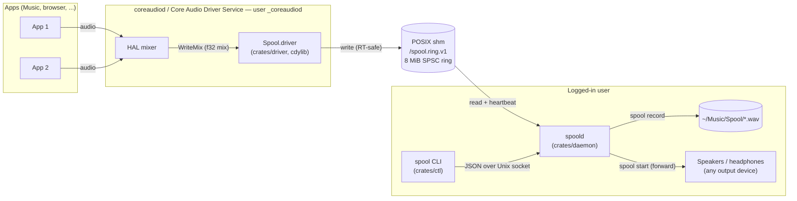

| Component | Crate | Runs as | Responsibility |
|---|---|---|---|
| Driver | `crates/driver` | `_coreaudiod`, inside the Core Audio host | Publishes the **Spool** output device. Copies the final mix into the ring. Nothing else. |
| Ring | `crates/ring` | Library used by both sides | Lock-free single-producer single-consumer ring in POSIX shared memory. |
| Daemon | `crates/daemon` (`spoold`) | User, launchd agent | Drains the ring, writes WAV files, forwards to a real device. |
| Protocol | `crates/proto` | Library | Request/response types and socket client. |
| CLI | `crates/ctl` (`spool`) | User | Sends one request per invocation. |

Why shared memory: the `coreaudiod` sandbox profile contains `(allow ipc-posix-shm)`, so
the driver can create the object without declaring Mach services. The object is mode
0666 because the producer (`_coreaudiod`) and the consumer (the user) are different
users. `fchmod`/`fchown` fail with `EINVAL` on macOS shm objects, so the creation mode
is final, and its group is always the creator's (`_coreaudiod`).

Trust model: any local process can map the ring, so neither side trusts the other's data.

- The producer adopts an existing object only if it owns it; otherwise it unlinks it and
  creates a new one with `O_EXCL`, or fails. It never writes audio into a planted object.
- The consumer attaches only to objects owned by `_coreaudiod` (or by itself, for test
  producers), and refuses while another consumer's heartbeat is fresh.
- Indices are range-checked, the format must pass `Format::is_valid` (1–64 channels,
  8–768 kHz), gain is clamped to [0, 1], and seqlock reads give up after a bounded
  number of retries. A hostile header costs audio, never memory safety or a hang.
- What remains: other local users can read or inject audio. Closing that needs group
  access (0660 plus membership in `_coreaudiod`) or handing the descriptor over Mach.

## 2. Crate dependencies

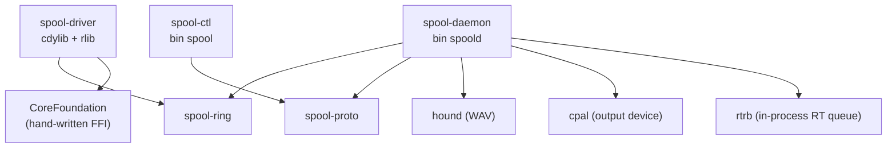

The driver depends only on `spool-ring` and `libc`. It is kept small because it runs
inside the system audio server, where a crash takes down audio for the whole machine.

## 3. Driver: the Core Audio object model

The HAL sees a fixed object tree. All calls arrive through the
`AudioServerPlugInDriverInterface` vtable in `crates/driver/src/lib.rs`, with FFI types in
`crates/driver/src/ffi.rs`.

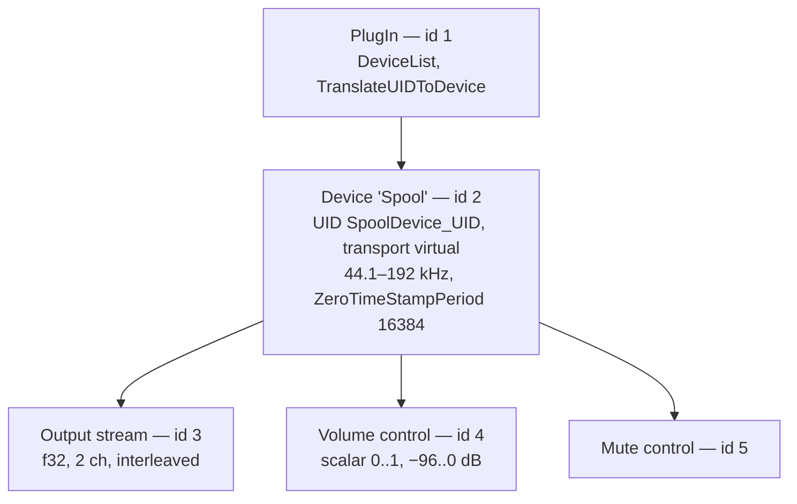

Driver lifecycle as the HAL drives it:

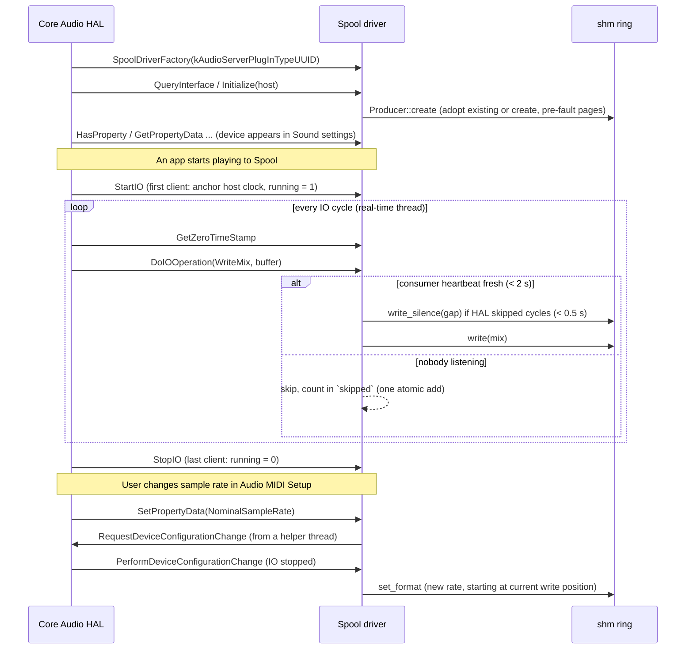

Volume and mute set from the volume keys are stored in the driver and published to the
ring header as `gain` and `muted`. The driver writes the raw mix. Whether gain is applied
is decided in the daemon (§6).

Real-time rules on the IO path (`do_io_operation`, `get_zero_time_stamp`): no allocation,
no locks, no syscalls, no logging. Every `extern "C"` entry point is wrapped in
`catch_unwind`, and release builds use `panic = "abort"`.

## 4. Shared-memory ring

### Layout

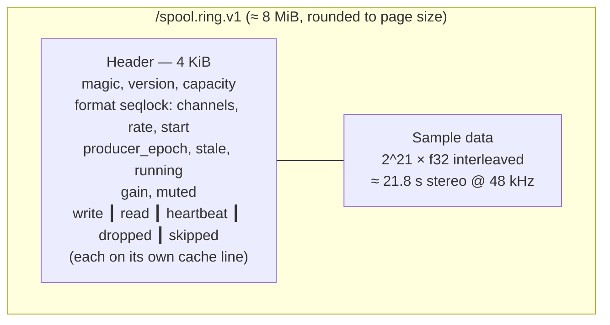

### Who writes what

| Field | Written by | Read by | Notes |
|---|---|---|---|
| `write` | driver | daemon | Monotonic sample counter, Release store after copying |
| `read` | daemon | driver | Monotonic sample counter |
| `consumer_heartbeat` | daemon | driver | Host ticks. The driver writes only while it is < 2 s old |
| `dropped` | driver | daemon | Samples dropped when the ring was full (newest are dropped) |
| `skipped` | driver | daemon | Samples not written because the heartbeat had lapsed. Appended later; older drivers leave it 0 |
| format seqlock | driver | daemon | Format and the sample position where it begins |
| `running`, `gain`, `muted` | driver | daemon | Device state for `spool status` and forwarding |
| `producer_epoch`, `stale` | driver | daemon | Detects a driver restart or a replaced object |

Every index read from the other process is range-checked. A corrupt header causes
dropped audio, never out-of-bounds access.

### Format changes

A sample-rate change happens while IO is stopped. The driver publishes
`(new format, start = write)` through the seqlock. The daemon reads `write` **before**
the format, so it always sees the format matching the data it is about to read. It drains
the old segment up to `start`, then switches. As a result, a single chunk never mixes
two formats.

### Lost audio

Positions alone don't show lost audio: a dropped or skipped sample is never written, so
`write` doesn't advance for it. The consumer therefore watches `dropped + skipped`, and
any change flags the next chunk as a discontinuity, which the recorder counts (`gaps` in
`spool record`).

### Restarts

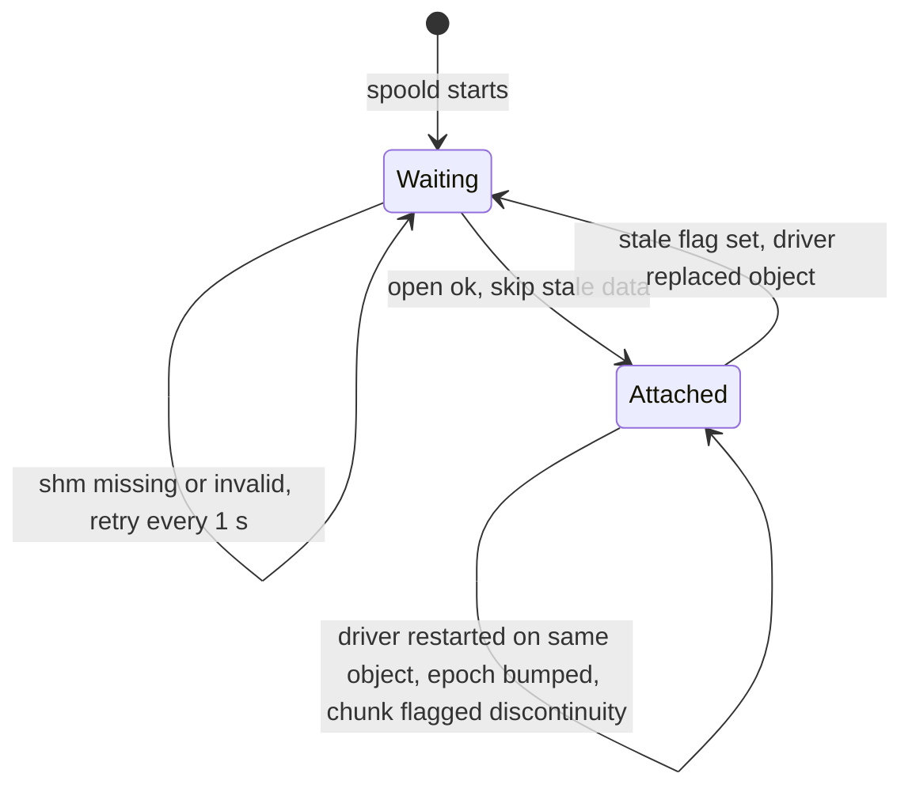

## 5. Daemon internals

`spoold` splits work by whether it may block:

- The **audio thread** (`audio.rs`) owns the ring consumer, the meter and the monitor's
  input queue. It never touches devices or disk, so its heartbeat keeps the driver
  writing even while the control thread is busy.
- The **control thread** (`main`) owns everything that can block: requests, device
  enumeration, opening and closing output streams, and WAV writing.
- A socket acceptor thread, short-lived connection threads, and the output device's
  real-time callback (only while forwarding) complete the picture.

A slow control thread therefore costs neither audio nor monitoring. Recording data waits
in the chunk channel, which holds up to 16 Mi samples (≈ 87 s of 48 kHz stereo). Beyond
that the audio thread drops chunks and flags the next one as a discontinuity.

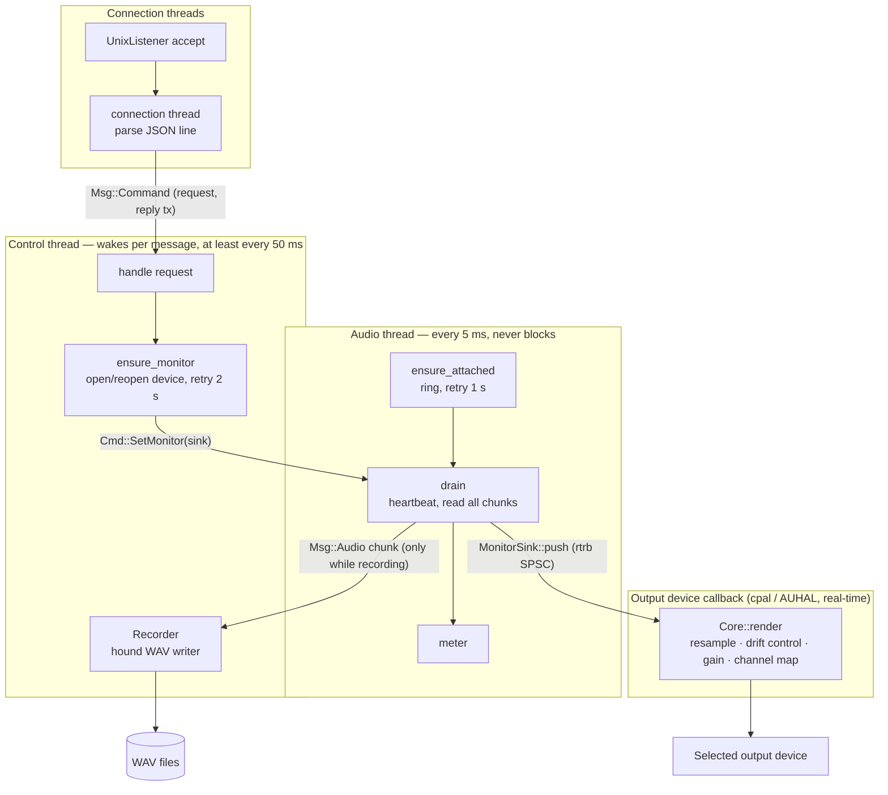

### Commands and state

Forwarding and recording are independent. `start` controls forwarding, `record` controls
recording, and `start --record` sets both.

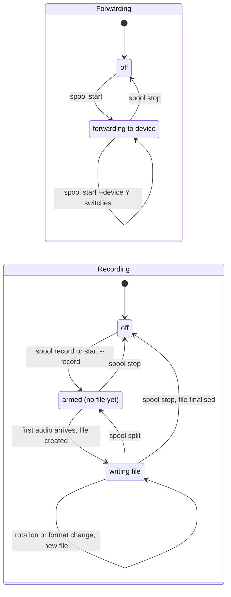

Device selection for `spool start` and `spool record`. A monitoring device is mandatory and
is never guessed. The daemon answers `no_device`, and the CLI asks the user and retries:

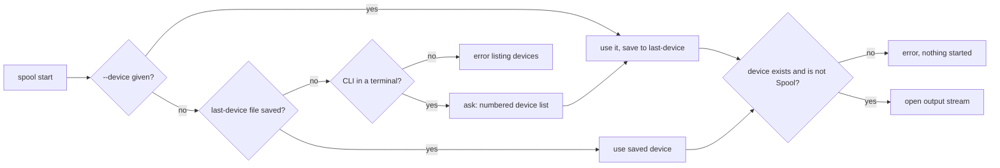

### Request flow example: `spool start --record`

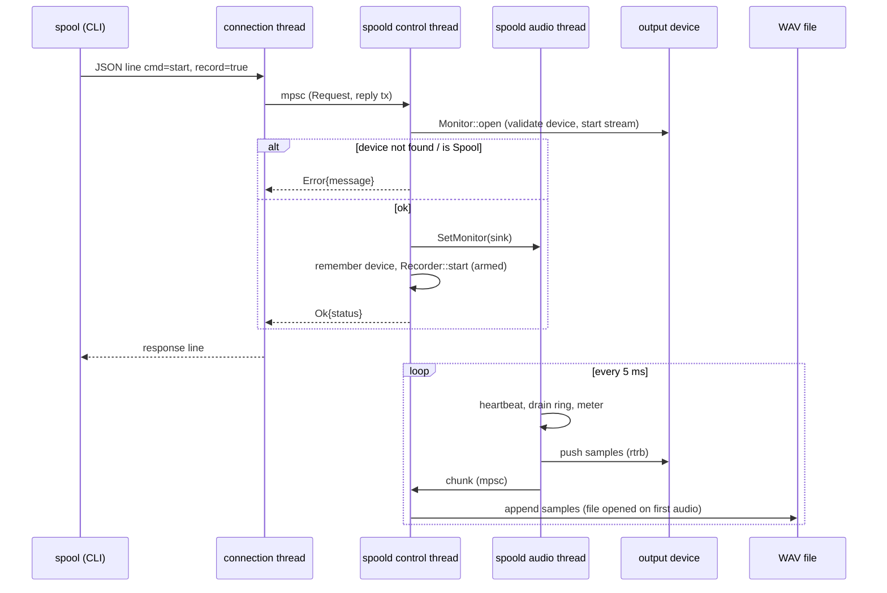

## 6. Forwarding (monitor) signal path

The virtual device runs on the host clock; the hardware runs on its own crystal and maybe
another sample rate (e.g. 48 kHz → 44.1 kHz). `Core` keeps latency constant instead of
letting the clocks drift apart.

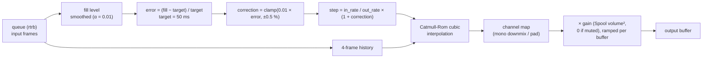

States of the callback:

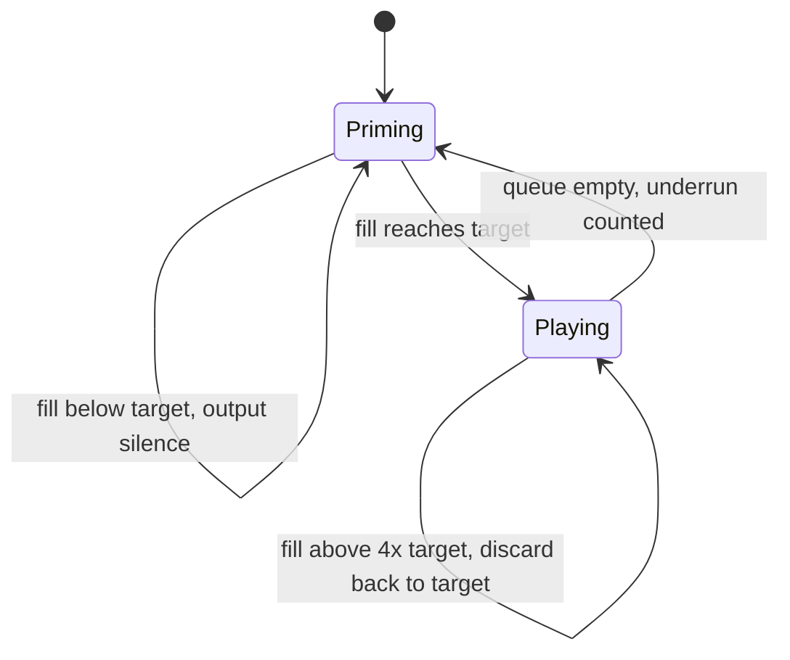

Gain handling differs by path:

| Path | Volume/mute applied? |
|---|---|
| Driver → ring | No, the raw mix is written. `gain`/`muted` are published in the header |
| Ring → forwarded device | Always, so the volume keys work while Spool is selected |
| Ring → WAV | Only with `spoold --post-fader`. By default the recording is the raw mix |

## 7. Recording

- Files are named `<prefix>-YYYY-MM-DD_HH-MM-SS.wav` (`-1`, `-2` on collision), as 32-bit
  float WAV in the ring's current format.
- A file is created on the first audio after `record`, so its header always matches.
- New files start on: format change, `--max-minutes`, `--max-mb`, the 4 GB WAV limit, or
  `spool split`. Empty files are deleted.
- The header is flushed every second, so a crash loses at most about 1 s.
- When no app plays, Core Audio stops IO and no samples arrive. The file pauses rather
  than filling with silence. Gaps inside a running stream (HAL overloads < 0.5 s) are
  filled with silence by the driver.

## 8. Failure handling

| Situation | Behaviour |
|---|---|
| Daemon not running | Heartbeat goes stale. The driver stops writing within 2 s. The device keeps working |
| Control thread blocked (device open, slow disk) | The audio thread keeps draining, heartbeating and forwarding. Recording data queues (≈ 87 s at 48 kHz stereo), then is dropped and flagged |
| Audio thread stalled (process suspended) | Ring fills and the driver drops the newest samples (`dropped`). If the heartbeat lapses, it stops writing and counts `skipped`. Either way the next chunk is flagged as a discontinuity |
| Audio thread panics | The control thread notices and exits; launchd restarts the daemon |
| Forward device unplugged | Stream error, daemon retries every 2 s, resumes when it returns |
| Forward queue full | Excess input dropped in the daemon. Recording is unaffected |
| `coreaudiod` restarts | Driver adopts the existing ring (epoch++) or replaces it (stale → daemon reattaches) |
| shm creation fails | Device still works. The error goes to the system log (`log stream --predicate 'eventMessage CONTAINS "Spool"'`) |
| Panic in driver | Caught at the FFI boundary (error code returned). Release builds abort |

## 9. Install layout

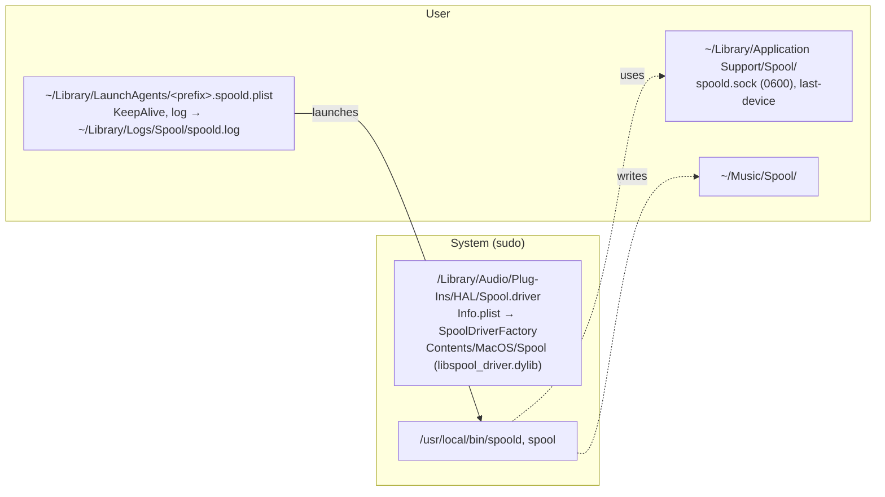

`scripts/install.sh` builds everything. It reinstalls the driver and restarts
`coreaudiod` only if the driver binary changed. Under SIP it uses `killall coreaudiod`
because `launchctl kickstart` is refused. It always reinstalls the binaries and restarts
the agent.

## 10. Testing map

| Test | Where | What it proves |
|---|---|---|
| Ring | `crates/ring/src/lib.rs` | Wraparound, full ring drops, whole frames, format boundaries, corrupt indices, restart adoption, heartbeat, lost-sample discontinuities, hostile headers, 2 M-sample concurrent ordering |
| Driver | `crates/driver/src/tests.rs` | The full vtable driven like the HAL with a fake host: object tree, properties, volume/mute, IO bit-exact into the ring, gap fill, timestamps, rate change |
| Recorder | `crates/daemon/src/recorder.rs` | Bit-exact float WAV, post-fader gain, rotation by time, size and format |
| Audio thread | `crates/daemon/src/audio.rs` | A 3 s control-thread stall (longer than the heartbeat timeout) loses no sample and flags no gap |
| Monitor core | `crates/daemon/src/monitor.rs` | Priming, exact passthrough at unity, 48 k→44.1 k pitch, +200 ppm drift absorbed over 5 min, underrun re-priming, gain ramp, downmix |
| Protocol | `crates/proto/src/lib.rs` | Wire format |
| Manual | `crates/ring/examples/tone.rs` | Stand-in driver for running `spoold` end-to-end without installing |
