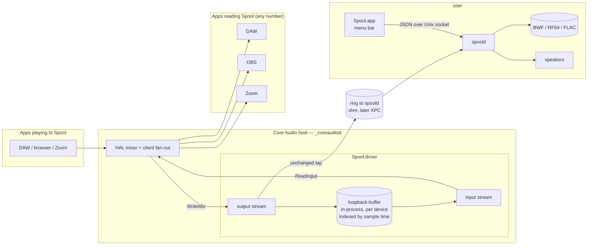
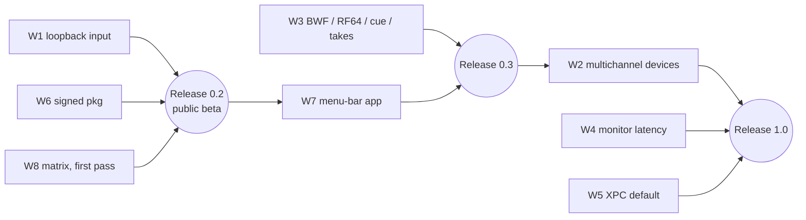

# Pro Readiness: Technical Design

Status: Draft
Related: [DESIGN.md](../DESIGN.md) (goals, roadmap), [ARCHITECTURE.md](ARCHITECTURE.md) (as built),
[XPC.md](XPC.md) (secure transport)

This document covers what has to change for Spool to be a credible choice for music
professionals (producers, mixing and mastering engineers, studios, streamers). The
comparison they will make is BlackHole, Loopback and similar routing tools. Spool today
is a recorder that looks like an output device. This plan makes it a loopback device that
also records, monitors and has working volume keys.

Every gap below was checked against the code, not only the docs.

## 1. Gaps

| ID | Gap | Where in the code | Weight for pros |
|---|---|---|---|
| G1 | **No input side.** The device publishes one output stream. No app can select Spool as an input, so there is no app-to-app routing. | `driver/src/lib.rs`: `DEVICE_ID` returns no streams for input scope; `WillDoIOOperation` accepts only `WriteMix` | Blocker |
| G2 | **Single consumer.** Only one process can attach to the ring. | `ring`: consumer heartbeat lock-out | Solved by G1 (§3.6) |
| G3 | **Latency.** Speaker monitoring targets 50 ms, goes through two queues and a resampler, and polls every 5 ms. | `daemon/src/monitor.rs`, `audio.rs` | High for play-through, low for listening |
| G4 | **Stereo only.** `CHANNELS: u32 = 2` is a compile-time constant. There is one device. | `driver/src/lib.rs:41` | Medium (stems, multi-bus) |
| G5 | **File limits.** WAV is capped at 4 GB (`WAV_HARD_LIMIT_BYTES`), 32-bit float only, and has no timestamp metadata. FLAC is planned only. | `daemon/src/recorder.rs` (hound) | Medium |
| G6 | **Timeline and integrity.** Idle time isn't recorded, overloads are filled with silence, and gaps are only counted, not marked in the file. | driver `do_io_operation`, recorder | Medium for safety recording |
| G7 | **World-readable ring** (mode 0666). | `ring`, [XPC.md](XPC.md) | Low for one-person studios; required before facility or site licenses |
| G8 | **Distribution.** Ad-hoc signed, no releases, install via `sudo` script, `coreaudiod` restart. | `scripts/` | Blocker |
| G9 | **CLI only.** No GUI. | `crates/ctl` | Blocker for most of the target group |
| G10 | **No published compatibility.** No test matrix across macOS versions, CPUs and DAWs. | DESIGN.md §7 | High (trust) |

Not gaps for this audience: sample rates above 192 kHz, per-app routing (stays a non-goal
from DESIGN.md §1), and Windows.

## 2. Target architecture



Main decisions:

- **Loopback stays inside the driver.** Output and input share one device clock, so the
  input path needs no resampling and no drift correction, and it adds no process hop.
- **The ring to `spoold` stays as it is.** It is a tap for recording and monitoring, not
  the routing path. Its format already supports 1–64 channels.
- **The HAL fans out to readers.** Any number of apps can open Spool's input, and
  Core Audio handles it. The ring never needs more than one consumer.
- **The GUI is a separate app** that talks to `spoold` over the existing control
  protocol. That keeps the Rust core small and lets the app be licensed separately.

## 3. W1: Loopback input stream (G1, G2, most of G3)

Size: M. It's the most valuable change, so it goes first.

Status: implemented on branch `g1-loopback-input` (`crates/driver/src/loopback.rs`, input
stream id 6), covered by the fake-host tests in §3.9. The post-fader switch (§3.5) is not
built yet. Waiting on the real-install checks in §11.1 and a first DAW/OBS run.
Deviation from §3.3: samples are `AtomicU32` with relaxed ordering instead of plain memory.
That compiles to the same loads and stores, and makes the cross-thread case in §11.1 safe
by construction, so the check decides only latency, not soundness. `written_until` is an
`AtomicI64`, stored with release after the samples and loaded with acquire before them.

### 3.1 Object model

| Object | ID | Change |
|---|---|---|
| Device | 2 | Input scope returns `[INPUT_STREAM_ID]` for `Streams` and `OwnedObjects`. `DeviceCanBeDefaultDevice` is true for input scope too. `Latency` and `SafetyOffset` are answered per scope. |
| Output stream | 3 | Unchanged |
| Volume, mute | 4, 5 | Unchanged (output scope) |
| **Input stream** | **6** | New: `Direction = 1`, `TerminalType = kAudioStreamTerminalTypeLine`, `StartingChannel = 1`, same formats as the output |

`kAudioObjectPropertyOwnedObjects` on the device lists all four children in the global
scope, and only the right ones per scope. Format changes go through the existing
`RequestDeviceConfigurationChange` path and are applied to both streams together, so
input and output always share a format.

### 3.2 IO operations

- `WillDoIOOperation`: `WriteMix` on stream 3 and `ReadInput` on stream 6, both in place.
- `DoIOOperation` dispatches on `(op, stream)`:
  - `WriteMix`: as now (ring tap, silence fill), **plus** copy into the loopback buffer
    at `cycle.mOutputTime.mSampleTime`.
  - `ReadInput`: copy from the loopback buffer at `cycle.mInputTime.mSampleTime` into
    the HAL buffer, then zero the region that was read.

### 3.3 Loopback buffer

```
capacity  = 65,536 frames (power of two, ≥ 4 × largest HAL buffer, ≥ ZeroTimeStampPeriod)
storage   = Box<[f32]> of capacity × channels, allocated when the device is created (non-RT)
index(t)  = (t as u64) & (capacity − 1)
```

- It's indexed by **sample time**, not by separate read and write positions. Because both
  operations run on the device timeline, data written for output time *T* comes out when
  the HAL asks for input time *T*. Nothing needs to be synchronized.
- **Only fresh frames come out.** The buffer keeps `written_until`, the sample time just
  past the latest write. A read returns a frame only if its time is in
  `[written_until − capacity, written_until)`, and silence otherwise. A write that skips
  ahead (HAL overload) zeroes the skipped frames inside that window. Together these make
  every slot in the window hold the frame for exactly its own time. Zero-on-read alone is
  not enough: frames written while nobody reads are never cleared, so a reader that joins
  while audio plays and keeps reading after it stops would hear them one wrap later
  (up to 1.36 s at 48 kHz; see [g1-stale-audio.html](g1-stale-audio.html)).
- **Zero-on-read** stays, so a span already heard doesn't come out twice. The buffer is
  also cleared in `start_io` when the first client starts (non-RT, under `control`).
- The HAL calls `ReadInput` and `WriteMix` for one device from its IO thread, and each
  once per cycle. The buffer is therefore single-writer and single-reader on one thread,
  so it can use plain memory with no atomics. **Verify this on a real install** (test
  plan §11) before relying on it. If the calls can come from different threads, switch
  to `UnsafeCell` slices with a release/acquire fence per operation.
- Memory: 2 ch is 512 KiB; 64 ch is 16 MiB per device.

### 3.4 Latency

The input lags real time and the output leads it, so the loopback delay is about the HAL
buffer size on each side plus safety offsets. At a 128-frame buffer and 48 kHz that is
about 5–6 ms, and nothing in Spool adds to it. Report `Latency = 0` and `SafetyOffset = 0`
on both streams so DAWs compensate correctly. Document the measured figure, don't claim
"zero latency".

### 3.5 Gain on the loopback path

Decision: **pre-fader by default**. Apps reading Spool get the raw mix, so turning the
volume down to listen quietly doesn't change what OBS or Zoom receive. This matches how
the recorder already defaults to raw. A custom device property
(`'spPF'`, `kSpoolPropertyLoopbackPostFader`, a bool persisted through the host's
`WriteToStorage`) switches to post-fader for users who want the volume keys to control
the stream. See open question Q2.

### 3.6 Effect on G2

DAWs, OBS and conferencing apps all read the input stream, and the HAL serves each one.
The ring keeps one consumer (`spoold`), which is the right design for it. A
multi-consumer ring is dropped from the plan.

### 3.7 Feedback

An app that reads Spool's input and plays back to Spool's output creates a loop. This is
inherent to loopback devices. The GUI shows a warning when a feedback loop appears to be
building (input RMS tracks output RMS with a constant delay and rising level), and the
docs explain it. The monitor already refuses Spool as its output device.

### 3.8 Privacy

Reading any input device triggers the macOS microphone permission prompt for the reading
app. Loopback audio therefore gets the same consent as a microphone. That is better than
the current ring (G7).

### 3.9 Tests (`driver/src/tests.rs`, fake host)

- Write N cycles, read at the same sample times: bit-exact.
- Read a range that was never written: zeros.
- Read after a wrap with no new writes: zeros (zero-on-read and the `start_io` clear).
- Reader joins while audio plays and outlives the writer: silence past `written_until`.
- Skipped span after a wrap nobody read: silence, not the previous wrap.
- Buffer sizes 32 to 4096, odd sizes, and wrap in the middle of a buffer.
- Rate change: both streams report the new format, and the buffer is cleared.
- Property tests on the object tree: scope-correct `Streams` and `OwnedObjects`.
- An allocation-detecting global allocator around `do_io_operation` for both operations
  (DESIGN.md §5).

## 4. W2: Channel counts and multiple devices (G4)

Size: L. It touches every layer.

### 4.1 Approach

Publish **several fixed-layout devices from one driver**, chosen by the user:

| Default set | Channels | Use |
|---|---|---|
| Spool | 2 | Everyday |
| Spool 16 | 16 | Stems, multi-bus routing |
| Spool 64 (optional, off by default) | 64 | Large sessions |

This is better than changing the channel count of one device at runtime. Apps cache
device layouts, and some DAWs handle a channel-count change mid-session badly. Separate
devices with stable UIDs (`SpoolDevice_UID`, `Spool16_UID`, …) keep sessions reopening
correctly.

### 4.2 Driver refactor

- Replace the global `STATE` with `struct Device { id_base, channels, name, uid, rate,
  volume, mute, io_clients, loopback, ring, … }` in a fixed array. The device set is
  decided when the driver is loaded.
- Object IDs come in blocks: device *n* has `2 + 16n`; its output stream, input stream,
  volume and mute follow at fixed offsets. Lookup is a range check, with no maps on the
  IO path.
- The configuration (which devices, and their names) lives in host storage
  (`CopyFromStorage` at `Initialize`, `WriteToStorage` on change). The sandbox doesn't
  restrict that, unlike reading a file. A custom plug-in property
  (`'spDV'`, list of `{channels, name, enabled}`) changes it at runtime: the driver
  updates its array outside IO and sends `kAudioPlugInPropertyDeviceList` changes.
  Devices are added or removed while they are idle. A device that's running is only
  changed after it stops.
- Every `CHANNELS` constant becomes `dev.channels`, including `asbd`,
  `channel_layout`, `PreferredChannelsForStereo` and the IO slice lengths.

### 4.3 Ring per device

- Ring names become `/spool.ring.v2.<uid-hash>`. The XPC transport deposits one entry per
  device.
- Capacity scales with channel count to cover a fixed time rather than a fixed sample
  count. The target is 20 s at 48 kHz, which is 7.3 MiB for stereo and 58 MiB for 16 ch.
  64 ch gets 5 s (59 MiB), and the daemon's drain thread runs at a higher QoS for it.
  `Format::is_valid` already allows 64 channels.
- Bump `VERSION` to 2. `spoold` refuses v1 rings with a clear message instead of
  guessing.

### 4.4 Daemon and protocol

- `spoold` holds one consumer per enabled device. One audio thread drains all of them,
  because one wake-up per 5 ms is enough.
- Recording is per device and can be armed independently. File names include the device
  (`Spool16-2026-…wav`).
- The monitor gets a channel-pair selector (for example 3/4 of 16 to the speakers). The
  existing channel map (`monitor.rs`) is generalized from downmix and pad to a source
  pair.
- Protocol: `Request` gains `device: Option<String>`. `Status` returns a list of device
  statuses. Old CLIs keep working against device 0.

## 5. W3: Recording formats and integrity (G5, G6)

Size: M.

### 5.1 Our own writer instead of hound

hound has no RF64, no `bext` chunk and no `cue` chunk. Add a small writer module
(`daemon/src/wav.rs`, about 400 lines, no new dependencies) that supports:

| Feature | Detail |
|---|---|
| **BWF `bext`** | `OriginationDate` and `OriginationTime` from the first sample's wall-clock time, and `TimeReference` = samples since local midnight. DAWs (Pro Tools, Logic, Reaper) can then drop the file at its original time ("spot to timestamp"). |
| **RF64** | Start as RIFF with a `JUNK` chunk sized for `ds64`. Switch the header to RF64 when the file passes 4 GiB. Remove `WAV_HARD_LIMIT_BYTES`; rotation by size or time stays as an option. |
| **Sample formats** | 32-bit float (default, bit-exact) and 24-bit PCM with TPDF dither (an option for archives and older tools). |
| **`cue` markers** | One marker per discontinuity (dropped, skipped, overload fill) and per manual `spool mark`. The markers show up in DAWs, so a damaged spot is visible instead of only counted. |
| **WAVE_FORMAT_EXTENSIBLE** | For more than 2 channels, with a channel mask, so 16-channel files open correctly. |
| **Crash safety** | Keep the once-per-second header flush. For RF64 also update `ds64`. A recovery pass on startup repairs the sizes in any file left without a final header. |

FLAC comes later through an encoder crate (to be evaluated in Q5). FLAC files get
`TIME_REFERENCE` as a Vorbis comment, the convention some tools read. Opus is dropped for
this audience.

### 5.2 Timeline modes

The user picks one (`--timeline`):

- **`takes` (new default):** when the device goes idle (`running = 0`) the current file
  is closed, and the next audio starts a new file with its own `bext` time. Every playback
  becomes its own take, and with timestamps, takes line up in a DAW.
- **`continuous`:** `spoold` writes silence for idle time, using the host clock to work
  out how much, so one file matches wall-clock time. This is meant for long safety
  recordings of a whole session.
- **`paused`:** today's behaviour.

### 5.3 Integrity guarantees we can state

- With `spoold` healthy, nothing is lost between the driver's `WriteMix` and the file.
  This is tested by the existing stall test and a long bit-exact soak (§11).
- Every loss shows up in the file as a `cue` marker and is counted in `status`.
- Overload fill stays (it keeps the timeline intact) but is now marked.

## 6. W4: Monitoring latency (G3, speaker path)

Size: S–M. Loopback (W1) is the low-latency path. This is about hearing yourself
through the speakers.

- **Read the ring directly in the output callback.** For the monitor, the hops through
  the audio thread and `rtrb` are removed. The ring is SPSC, so the monitor gets its own
  consumer, a **second tap ring**, written by the driver only while monitoring is on (a
  header flag). The recording path keeps the existing ring and the 87 s of headroom.
- **Adaptive target:** latency target = output buffer size × 2 + 2 ms, with a floor of
  5 ms. It replaces the fixed 50 ms. The drift controller in `Core` stays the same; only
  the target changes.
- If the output device runs at the same rate and in the same clock domain (rare for
  hardware, but true for another Spool device), skip resampling.
- `status` reports the measured monitor latency.

Expected: 10–15 ms at 128-frame buffers on built-in output. That's fine for listening
and borderline for playing through. Performers who need less should route through the
loopback into their DAW and monitor from there. The docs say this plainly.

## 7. W5: Secure transport (G7)

Size: per [XPC.md](XPC.md) stages 1–4. Not repeated here. Changes from this document:

- One memory entry per device (W2) and, if W4 ships, one per tap ring. The broker
  protocol deposits a list keyed by device UID.
- Target: XPC as the default before selling facility or site licenses. Individual users
  can stay on shm for the first public releases, with the warning that's already in the
  README.

## 8. W6: Distribution (G8)

Size: M. Mostly tooling, little code.

| Item | Detail |
|---|---|
| Universal binaries | `cargo build --target aarch64-apple-darwin` and `x86_64-apple-darwin`, combined with `lipo`, for the driver, `spoold`, the CLI and the broker |
| Signing | Developer ID Application for binaries, with hardened runtime and no extra entitlements. Developer ID Installer for the pkg. `SIGN_IDENTITY` already exists in `build-bundle.sh`. |
| Packaging | `pkgbuild` components (driver, binaries, LaunchAgent template, app) plus a `productbuild` distribution, with a postinstall script that restarts `coreaudiod` (the logic is already in `install.sh`) |
| Notarization | `xcrun notarytool submit --wait`, then `xcrun stapler staple` in CI on a tagged release |
| Install UX | The installer's readme page says that **system audio drops out for about a second** during install. The postinstall defers the restart while any Spool device is running, and retries for up to 60 s. |
| Agent registration | From the app with `SMAppService.agent(plistName:)` (macOS 13+), not by copying a plist into `~/Library/LaunchAgents`. That shows up correctly in System Settings → Login Items. |
| Updates | Sparkle 2 in the app for app, daemon and CLI updates. Driver updates go through a new pkg, because a restart of `coreaudiod` must always be the user's choice. |
| Version checks | Driver, `spoold` and the app exchange versions (ring header and a `Hello` request). A mismatch shows "restart required" instead of failing silently. |
| Uninstall | `uninstall.sh` stays, and the app gets an "Uninstall Spool…" menu item that runs it with admin rights |
| Homebrew | A cask pointing at the notarized pkg |

## 9. W7: GUI app (G9)

Size: L.

### 9.1 Technology

A **SwiftUI menu-bar app** (`apps/Spool.app`, Swift Package). Reasons:
`MenuBarExtra`, `SMAppService`, Sparkle and notarization are all native and simple,
and the app does no audio work. Rust UI options (egui, Tauri) were considered; they make
the menu-bar, login-item and signing integration harder for no gain.

The app embeds `spoold` and `spool` in `Contents/MacOS/`. The pkg installs only the
driver and the app.

### 9.2 Protocol additions (`crates/proto`)

The protocol is JSON lines over a Unix socket today, one request per connection. It
needs:

| Addition | Why |
|---|---|
| `Hello { version }` | Version check (§8) |
| `Subscribe { topics: [status, meters, files] }` | A long-lived connection where `spoold` pushes status changes and meters at 20 Hz instead of the app polling |
| `Config { get / set }` | Devices (W2), timeline mode, file format, folder, rotation, monitor device and channel pair, post-fader |
| `Mark { label }` | `cue` marker (W3) |
| `Recordings { list }` | Recent files with duration, size and gap count, for the menu |

The protocol is versioned and stays MIT. The app is a client like the CLI, so it can be
licensed separately.

### 9.3 Scope of version 1

- Menu bar: record button (with a red dot while recording), elapsed time, a level meter
  per device, monitor on/off and device picker, "Open recordings folder", last 5
  recordings (drag into a DAW).
- Settings window: devices and channel counts, file format, timeline mode, folder,
  rotation, loopback pre/post-fader.
- Status: XPC or shm, discontinuities, disk space left with a warning below 10 GB.
- Shortcuts: a global hotkey for record and mark.

## 10. W8: Compatibility and test matrix (G10)

Size: M, ongoing.

| Axis | Values |
|---|---|
| macOS | 14, 15, 26, 27 (13 is supported best-effort; process taps need 14.2) |
| CPU | Apple Silicon, Intel |
| Hosts | Logic Pro, Pro Tools, Ableton Live, Reaper, Cubase |
| Apps | Zoom, Teams, OBS, Chrome, Safari, Music, QuickTime |

Automated, on a self-hosted Mac runner. Hosted runners probably can't load HAL drivers
reliably; **check this before relying on them**.

- **Loopback bit-exactness:** a test client plays a known signal to Spool output while a
  second client reads Spool input, and they compare after aligning by sample time. Run
  at every supported rate and channel count.
- **Recording soak:** 8 h of a pseudo-random signal; the recorded files are compared
  against the generator, with zero mismatches and zero `cue` markers.
- **Drift:** 8 h monitoring to hardware, with latency bounded at the target ±2 ms and no
  underruns after priming.
- **Stress:** start and stop clients 1000 times, rate changes during playback,
  `coreaudiod` restarts, killing `spoold` during recording followed by the recovery pass.
- **Allocation test** on the IO path (DESIGN.md §5).

Manual, per release: a checklist per host (select Spool as input and output, record 10
minutes, change the rate, reopen the session).

The result is published as a compatibility table in the docs and on the website. For
this audience, that table is a selling point.

## 11. Verification needed on a real install

These assumptions decide how parts of the design work, and only a real Core Audio host
can confirm them. Each gets a small spike before the related work starts.

1. `ReadInput` and `WriteMix` for one device run on the same thread, once per cycle
   (W1 §3.3).
2. `CopyFromStorage` and `WriteToStorage` work from the plug-in's host process on macOS
   26 and 27 (W2).
3. Adding and removing devices at runtime through `DeviceList` notifications is picked
   up by Logic and Pro Tools without a restart (W2). If not, device changes take effect
   on the next `coreaudiod` restart, and the app says so.
4. The XPC spike findings ([XPC.md](XPC.md) §10).

## 12. Order and dependencies



| Release | Contains | Message to users |
|---|---|---|
| 0.2 | W1, W6, first matrix | "A loopback device that also records, lets you hear it, and the volume keys work. Signed installer." |
| 0.3 | W3, W7 | "Menu-bar app. Timestamped takes that drop into your DAW at the right time." |
| 1.0 | W2, W4, W5, full matrix | "16 and 64 channels, low-latency monitoring, secure by default, tested with your DAW." |

W1 doesn't depend on the multi-device refactor. It's built on today's single `STATE`,
and W2 then generalizes it. That gets the most-requested feature out first, and W2's
refactor is mostly mechanical once the input stream exists.

## 13. Open questions

- **Q1** Should the default device set be 2 ch plus 16 ch from the start, or 2 ch only
  with more channel counts opt-in in Settings? Fewer devices means less clutter in every
  app's device menu.
- **Q2** Pre- or post-fader as the default for the loopback (§3.5)? Pre-fader is
  consistent with recording. Post-fader matches what users expect from the volume keys
  when streaming. Ask beta users.
- **Q3** Should `continuous` timeline mode be the default for safety recording instead of
  `takes`?
- **Q4** Is the monitor tap ring (W4) worth a second ring, or is an adaptive target on
  the current path enough? Measure the current path at a 5 ms target first.
- **Q5** FLAC encoder: a pure-Rust crate versus bundling libFLAC. Criteria are
  correctness against `flac -t`, speed at 16 ch / 96 kHz, and licence (libFLAC is
  BSD-3).
- **Q6** Minimum macOS: drop 13? `SMAppService` needs 13, and process taps need 14.2 if
  that path is ever added.
