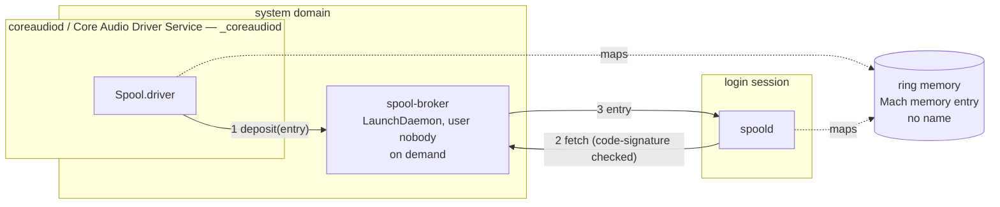

# XPC Transport (beta)

Status: Draft. Stage 0 (spike) is implemented and still needs a run on a real install.
Related: [DESIGN.md](../DESIGN.md) §11, [ARCHITECTURE.md](ARCHITECTURE.md) §1 (trust model).

"XPC" here means handing memory between processes through launchd Mach services. The
implementation uses plain Mach messages rather than libxpc (see §6). The name stays
because it is what users see (`spool transport xpc`).

## 1. Problem

The driver and `spoold` share audio through the POSIX shared-memory object
`/spool.ring.v1`. Its mode has to be 0666:

1. The producer runs as `_coreaudiod` and the consumer as the logged-in user.
2. The object's group is always the creator's (`_coreaudiod`).
3. `fchmod` and `fchown` fail with `EINVAL` on macOS shm objects, so the creation mode is final.
4. The Core Audio sandbox allows creating the object, but there is no way to hand it to one process.

Consequences, while Spool is the output device:

| Threat | Effect |
|---|---|
| Any process that isn't sandboxed (any user) reads the data region | Hears everything played to Spool, plus the last ~21.8 s left in the ring after playback stops. No TCC prompt, unlike reading BlackHole's input or a process tap. |
| …writes the data region | Injects audio into recordings and forwarding. |
| …writes `consumer_heartbeat` | Keeps the driver writing after `spool stop`, and locks the real `spoold` out ("another consumer is attached"). |
| …writes `read`, `gain`, `muted`, `stale` | Lost audio, muted forwarding, forced reattach. Contained by validation. |

What already holds (unchanged by this design): squatting is refused on both sides, every
header value is validated, and only one consumer can be attached.

## 2. Goals and non-goals

Goals

- Only the driver and an authenticated `spoold` can map the ring. No name exists that
  anyone else can open.
- Off by default during the beta. Turned on and off by an administrator only, so another
  process can't switch a user back to shm.
- One driver build and one signed package for both transports.
- The ring format, `Producer` and `Consumer` stay the same. Only how the memory is
  obtained changes.

Non-goals

- Protecting finished WAV files in `~/Music/Spool`. Those follow normal Unix permissions.
- Defending against root, or against code that has already been injected into `spoold`.
- Switching transport while audio is running. A switch restarts `coreaudiod` (§4).

## 3. Overview



1. When the driver is loaded, a helper thread creates the ring as a Mach memory entry
   (`mach_make_memory_entry_64` with `MAP_MEM_NAMED_CREATE`), maps it, and deposits a send
   right with the broker.
2. `spoold` looks up the broker and asks for the ring. The broker checks the request's
   audit token, which comes from the kernel and not from the message.
3. The broker replies with a send right to the entry. `spoold` maps it, and the existing
   ring protocol (positions, heartbeat, seqlock, epoch) runs unchanged.

The broker never touches audio. It only holds a port and decides who gets a copy. It
needs no privileges, so it runs as `nobody`.

Why a broker at all: the plug-in's sandbox can only look up Mach services it declares in
`AudioServerPlugIn_MachServices`. It can't register any service itself. `spoold`'s
LaunchAgent lives in the login session, which isn't visible from the system domain.
A LaunchDaemon is the meeting point both sides can reach.

## 4. Turning it on

**The broker being registered with launchd means XPC is on.** The driver doesn't read
any configuration. It looks up `<prefix>.spool-broker` (prefix: §5, Identifiers):

| Lookup result | Driver behaviour |
|---|---|
| Service unknown (`0x44e`) | shm transport, as today |
| Found, deposit succeeds | XPC transport. `/spool.ring.v1` is never created and an old one is unlinked |
| Found, deposit fails | XPC transport, skipping audio and retrying. **Never falls back to shm silently**: that would reopen the hole without the user knowing |

Only root can add or remove a LaunchDaemon, so only an administrator can change the
transport. The driver's `Info.plist` always declares the service. That entry does
nothing while the broker is absent, and the bundle stays the same either way.

### Development builds

```sh
scripts/install.sh --xpc     # installs the broker first, then the driver; restarts coreaudiod
scripts/install.sh           # without --xpc: removes the broker again
```

Ad-hoc builds have no team ID to check (§7), so the broker can only pin `spoold` by
hash. Dev installs give weaker guarantees than release installs and must say so.

### Release (signed, notarized `.pkg`)

The package always installs the broker binary and its LaunchDaemon plist, with
`Disabled = true` in the plist. Users switch with:

```sh
spool transport                 # transport: shm (default) | xpc (beta)
sudo spool transport xpc        # launchctl enable + bootstrap, restart coreaudiod
sudo spool transport shm        # bootout + launchctl disable, restart coreaudiod
```

- **Updates keep the user's choice.** `launchctl enable`/`disable` writes launchd's
  override database, which takes precedence over the plist's `Disabled` key. Postinstall
  bootstraps the broker only if it is currently enabled.
- **Graduating from beta:** ship the plist without `Disabled = true`. XPC becomes the
  default, and users who ran `spool transport shm` keep their override.
- **MDM and Homebrew** install the pkg and run the command. Optionally the pkg can offer
  a "Customize" choice (off by default) that does the same as `spool transport xpc`. A
  cask can preselect it through `choices`.
- The uninstaller removes the broker, its plist and the override.

## 5. Components

| Component | Change |
|---|---|
| `crates/mach` (new) | Hand-written Mach FFI: lookup/check-in, memory entries, two message types, audit trailers. No libxpc, no dispatch, no Objective-C runtime inside `coreaudiod`. |
| `crates/broker` (new) | `spool-broker`: holds the deposited entry, authenticates both sides, replies to fetches. `--probe` is the spike's client. |
| `crates/ring` | `Mapping` gets a second constructor taking a `spool_mach::Shared` instead of an shm fd. `Producer::create_anonymous` and `Consumer::from_shared` mirror `create`/`open`, with the same validation. The owner checks move to the broker (§7). |
| `crates/driver` | Transport is chosen on a helper thread at `Initialize`, per §4. The IO path is unchanged: it writes to whichever `Producer` is installed. Registers a dead-name notification on the broker port, so it re-deposits if the broker restarts. |
| `crates/daemon` | `ensure_attached` tries the broker first, then shm. `--transport auto\|shm\|xpc` forces one for testing. Checks the responder's identity on every fetch (finding S1). |
| `crates/ctl` | `spool transport [xpc\|shm]`. `spool status` shows `transport:`. |

### Identifiers

Every name Spool registers with macOS shares one reverse-DNS prefix:
`<prefix>.spool.driver` (bundle ID), `<prefix>.spoold` (LaunchAgent) and
`<prefix>.spool-broker` (LaunchDaemon label and Mach service). `scripts/spool-id.sh`
resolves it at build time: `$SPOOL_ID_PREFIX` if set, otherwise the `origin` remote
(`github.com/<owner>` → `io.github.<owner>`, other hosts → reversed host plus owner),
otherwise `local.spool`. A fork therefore gets its own names and can't collide with
upstream in launchd's system domain.

- `crates/mach/build.rs` bakes the prefix into `SERVICE_NAME`.
- `scripts/build-bundle.sh` exports the same value to cargo, fills the `@SPOOL_ID@`
  templates (`bundle/Info.plist`, `launchd/*.plist`) into `target/`, checks that the
  broker binary carries the matching name, and writes `target/spool-id`.
- `scripts/install.sh` installs what was built and records the prefix in
  `/usr/local/share/spool/id`. If the prefix changes, it removes the agent and broker
  installed under the old names first. Installed plists keep launchd's
  `<label>.plist` convention.
- Release builds should set `SPOOL_ID_PREFIX` explicitly in CI, so a release never
  depends on how the build machine's checkout was cloned. Changing the prefix after a
  release resets the launchd override that holds the user's transport choice (§4).

## 6. Protocol

Plain Mach messages, one request each, all with `MACH_SEND_TIMEOUT`. Receivers ask for
`MACH_RCV_TRAILER_AUDIT` and authenticate from the kernel's audit token.

| id | Direction | Body | Reply |
|---|---|---|---|
| `0x53500001` deposit | driver → broker | port descriptor (memory entry, `COPY_SEND`), `size: u64` | none |
| `0x53500002` fetch | client → broker | header only; reply port is `MAKE_SEND_ONCE` | `0x53500003` |
| `0x53500003` fetch reply | broker → client | port descriptor (entry or `MACH_PORT_NULL`), `size: u64` | none |

Rules: messages must match their exact size and descriptor layout, sizes are capped at
64 MiB, and anything else is destroyed with `mach_msg_destroy` so no rights leak. Stage 1
adds a protocol version to the body and an epoch to the deposit, so `spoold` can tell
that the driver has restarted (open question Q2).

Why not libxpc: it would give the same kernel objects (`xpc_shmem_create` wraps a memory
entry), but would run dispatch queues and blocks inside the system audio server. About
400 lines of Mach FFI are easier to review and keep off the IO path.

## 7. Security model

| Check | By | Mechanism | Stage |
|---|---|---|---|
| Depositor is the Core Audio host | broker | audit token euid = `_coreaudiod`, plus code signature: an Apple platform binary (`coreaudiod` or Core Audio Driver Service) | 3 |
| Fetcher is the real `spoold` | broker | code-signing requirement from the audit token: same team ID, identifier `spoold`. Dev builds pin the cdhash of the installed binary | 3 |
| Fetcher is the console user | broker | audit token euid equals the console user's uid (`SCDynamicStoreCopyConsoleUser`) | 3 |
| Responder is the real broker (S1) | `spoold` | reply audit token: euid `nobody`, plus the broker's code signature | 2 |
| Driver talks to the real broker | driver | it can only look up services in the system domain, where registering needs root | n/a |

What closes and what's left:

- **Closed:** other users, other processes of the same user, and heartbeat forgery. The
  ring has no name, so only holders of the entry can map it.
- **Left:** root, code injected into `spoold` (hardened runtime makes this hard), and
  weaker protection on ad-hoc dev builds. `spoold` keeps read/write access because it
  writes `read` and the heartbeat.
- **Possible hardening (not planned):** split the ring into a data entry, mapped
  read-only for `spoold`, and a small control page that `spoold` can write.

## 8. Failure behaviour

| Event | Behaviour |
|---|---|
| Broker crashes | launchd relaunches it on the next lookup. The driver's dead-name notification fires, so it re-deposits the same entry. `spoold` keeps its mapping and doesn't notice. |
| `spoold` restarts | Fetches the same entry again. Normal attach (skip stale data, heartbeat). |
| `coreaudiod` restarts | New memory, new deposit, which replaces the old one in the broker. `spoold` is still mapped to the old memory, which has gone quiet. Stage 2 sets `stale` in the old header when the driver unloads, plus a broker "changed" message (Q2), so `spoold` fetches again. |
| Broker registered but failing | The driver skips audio and retries every 2 s. `spool status` reports `transport: xpc (broker unreachable)`. |
| Lookup denied by the sandbox | Logged once. The driver treats it like "broker failing", never as permission to use shm. |

## 9. Stages

| # | Content | Done when |
|---|---|---|
| 0 | **Spike** (implemented): `crates/mach`, `spool-broker`, driver feature `xpc-probe`, `install.sh --xpc`. The driver deposits a 16 KiB probe page with no audio. Audio stays on shm. | §10 passes on a real install on macOS 26 and 27 |
| 1 | Ring over a memory entry. Driver transport selection with no fallback. Protocol version and epoch. | Unit tests in `crates/ring`. The driver vtable test runs both transports. |
| 2 | `spoold` fetch, responder check (S1), reconnection (§8), `--transport`, status line | End-to-end recording over XPC; `coreaudiod` restart test |
| 3 | Code-signing requirements, pkg with the broker disabled, `spool transport`, uninstaller | Notarized pkg; upgrade keeps the user's choice |
| 4 | GA: ship the plist enabled | One release with no XPC-only bug reports |

## 10. Spike runbook (stage 0)

```sh
scripts/install.sh --xpc                       # sudo; restarts coreaudiod
/usr/local/libexec/spool-broker --probe        # as yourself
log show --last 5m --predicate 'eventMessage CONTAINS "Spool"'
```

Expected on success:

```
Spool: XPC probe: plug-in hosted by <process> (pid …, uid 202)
Spool: XPC probe: ok looked up <prefix>.spool-broker
Spool broker: serving <prefix>.spool-broker (pid …, nobody)
Spool broker: deposit from pid … (_coreaudiod): 16384 bytes, probe page written by pid … (_coreaudiod)
Spool: XPC probe: PASS deposited the probe page with the broker
Spool broker: fetch from pid … (you): handing over the entry
```

and `--probe` prints `answered by pid … (nobody)` and `PASS driver → broker → user process works`.

| Observation | Meaning | Next step |
|---|---|---|
| `hosted by coreaudiod` or `hosted by Core Audio Driver Service` | Answers DESIGN.md §11 | Record it here |
| Driver: `FAIL lookup … Unknown service name (0x44e)` | Broker not registered, or registered in a domain the host can't see | `sudo launchctl print system/$(cat target/spool-id).spool-broker`; check the install order |
| Driver: `FAIL lookup … Permission denied` (`0x44c`) or a Sandbox violation in `log show --predicate 'sender == "Sandbox"'` | `AudioServerPlugIn_MachServices` isn't honoured for this host | **Blocks the design.** Look into alternatives (Q1) |
| Driver PASS, but `--probe` fails to map | Memory entries can't cross from this host to a user process | Try `fileport`/fd passing instead (Q1) |
| `--probe`: `answered by … (<you>)` | Something in your session shadows the broker (S1) | Expected if you ran `spool-broker` by hand |

To undo: `scripts/install.sh` (without `--xpc`) or `scripts/uninstall.sh`.

### Findings so far

- **S1 (verified locally, 2026-11-22): the service name can be shadowed in a login
  session.** An unprivileged `spool-broker` started by hand succeeded at
  `bootstrap_check_in` for the broker's service name in the user's session.
  `--probe` from the same user then looked up and talked to that process. So any process
  in the session can impersonate the broker towards `spoold`. Clients must authenticate
  the responder (§7). The driver isn't affected, because it looks up from the system
  domain. `fetch` now reports the responder, and `--probe` warns when it isn't `nobody`.
- In-process tests (`cargo test -p spool-mach`) pass: memory entries share pages both
  ways, the audit token reports the right pid and euid, the fetch round trip works,
  foreign messages are rejected, and oversized maps are refused.

## 11. Open questions

- **Q1** Does the plug-in's host honour `AudioServerPlugIn_MachServices` for a
  third-party LaunchDaemon on macOS 26 and 27? The spike answers this. Fallbacks if not:
  fd passing through `fileport_makeport` (private API), or a shm object with a random
  name that is unlinked once `spoold` has mapped it (only narrows the window).
- **Q2** How should `spoold` learn about a new deposit after a `coreaudiod` restart:
  `stale` in the old header plus polling the broker, or a subscription message from the
  broker? Leaning towards the subscription: it's one more message id and avoids polling.
- **Q3** Should the broker accept deposits only from a platform binary with euid
  `_coreaudiod`, or also pin the hosting process's signing identifier once Q1 tells us
  which process that is?
- **Q4** What should `spool transport` do when run without sudo: print the command, or
  ask for an admin password through `osascript`?
